# 🗂 구가은 포트폴리오

개인 프로젝트와 팀 프로젝트를 구분해 모았습니다. 각 프로젝트의 상세 내용은 해당 저장소 README에 있습니다.

## 👤 개인 프로젝트

| 프로젝트 | 한 줄 소개 | 주요 기술 | 링크 |
|---|---|---|---|
| 🎟️ **Ticketing** | 티켓 오픈 시 동시 접속에도 초과 판매·중복 예매 없이 처리하는 선착순 예매 서비스. 락 방식별 동시성 성능을 수치로 비교 | `Java 17` `Spring Boot 3` `Spring Data JPA` `Spring Security` `JWT` `Oracle 19c` `MySQL` `k6` `JUnit 5` `Swagger` | [Repo](https://github.com/Gugaeun/Ticketing) |
| 🌫 **PM25** | 서울 25개 구 평균 PM2.5를 1~24시간 뒤까지 예측. baseline 비교, 기상 변수 효과 검증, 고농도 실패 분석, ONNX 변환과 API 서빙까지 | `Python` `PyTorch` `LSTM` `1D-CNN` `LightGBM` `statsmodels(ARIMA)` `pandas` `ONNX` `FastAPI` `pytest` | [Repo](https://github.com/Gugaeun/PM25) |
| 🎮 **mini-game-hub (ARCADIA)** | 직접 만든 미니게임 10개를 모은 아케이드 웹사이트. 취향 기반 게임 추천, GitHub Pages 배포 | `React 18` `Vite` `React Router` `Canvas` `WebAudio` `Cloudflare Worker` `GitHub Pages` | [Repo](https://github.com/Gugaeun/mini-game-hub) · [Demo](https://gugaeun.github.io/mini-game-hub/) |
| 👁 **Vision_ai** | Vision AI 실습 겸 미니 프로젝트 8종 모음. 볼펜 탐지, 진열대 이상 탐지(Grounding DINO·YOLO-World·YOLOE 3종 비교), 자세 분류→이모지 변환, 군중 인구통계, 고랑 안 잡초 탐지, PatchCore 강건성 실험 | `Python` `YOLOv8` `YOLO-Pose` `Grounding DINO` `YOLO-World` `YOLOE` `XGBoost` `DeepFace` `PatchCore` | [Repo](https://github.com/Gugaeun/Vision_ai) |
| 🛰 **EuroSAT-Classification** | EuroSAT 위성 이미지 27,000장(10클래스)으로 ANN·DNN·CNN을 Keras·PyTorch로 구현한 6개 모델 비교. CNN이 가장 적은 파라미터로 최고 정확도(PyTorch 93.7%) | `Python` `Keras/TensorFlow` `PyTorch` `Google Colab` | [Repo](https://github.com/Gugaeun/EuroSAT-Classification) |
| 🍚 **golmok-hankki (골목 한끼)** | 중곡·군자·화양·능동 음식점을 모아 검색과 지도로 보여주는 서비스. 인허가 자료와 구청 모범음식점 크롤링 데이터를 합침 | `Python` `Flask` `SQLite` `Requests` `BeautifulSoup` `Naver Maps API` `Naver Geocoding API` | [Repo](https://github.com/Gugaeun/golmok-hankki) |

## 👥 팀 프로젝트

| 프로젝트 | 한 줄 소개 | 주요 기술 | 링크 |
|---|---|---|---|
| 🚗 **LPR_System** | 영상에서 차량 번호판을 검출·인식해 입·출차 기록을 SQLite에 저장하고 SQL로 분석하는 번호판 인식 주차 관리 시스템 | `Python` `YOLOv11` `ByteTrack` `PaddleOCR` `OpenCV` `PyQt6` `SQLite` `Streamlit` `Plotly` | [Repo](https://github.com/Gugaeun/LPR_System) |
| 🎬 **Korea_Movie_Review** | 한국어 영화 리뷰 26,768건(214편)으로 영화를 추천하는 서비스. 리뷰 유사도·영화 정보·보정 평점을 합친 콘텐츠 기반 추천 | `Python` `FastAPI` `scikit-learn(TF-IDF)` `pandas` `scipy` `React` `Docker` `pytest` | [Repo](https://github.com/Gugaeun/Korea_Movie_Review) |
| 🌿 **Korean_Travel (산책 ON)** | 지역별 산책 코스를 지도로 보여주고 기상청 예보·특보를 함께 확인하는 여행 웹 | `HTML` `CSS` `JavaScript` `Kakao Maps API` `Python(http.server)` `기상청 단기·중기예보 API` | [Repo](https://github.com/Gugaeun/Korean_Travel) |

## 🖼 미리보기

### 👤 개인 프로젝트

**🎟️ [Ticketing](https://github.com/Gugaeun/Ticketing)** — 예매 화면 · 공연 상세·회차 선택 · API 문서(Swagger)

  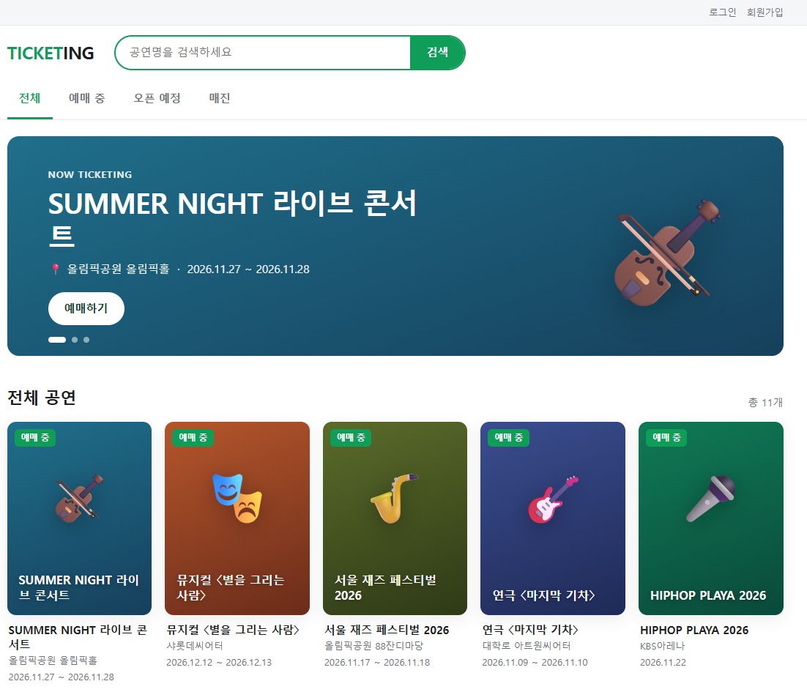
  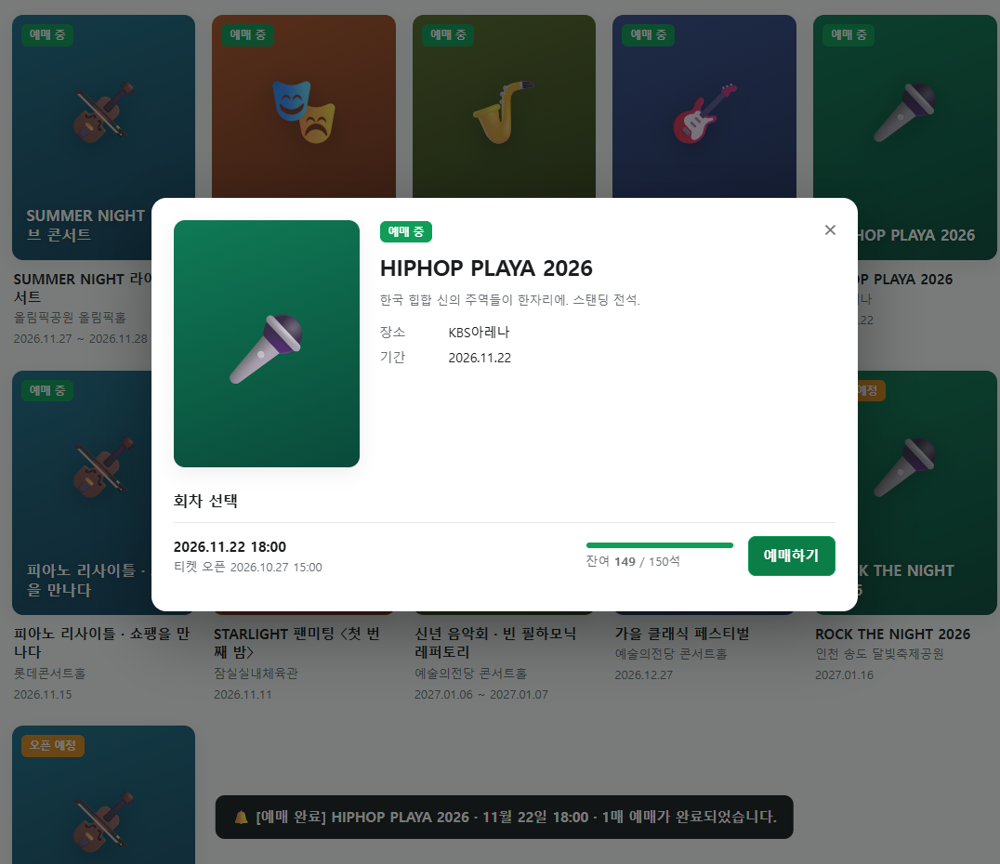
  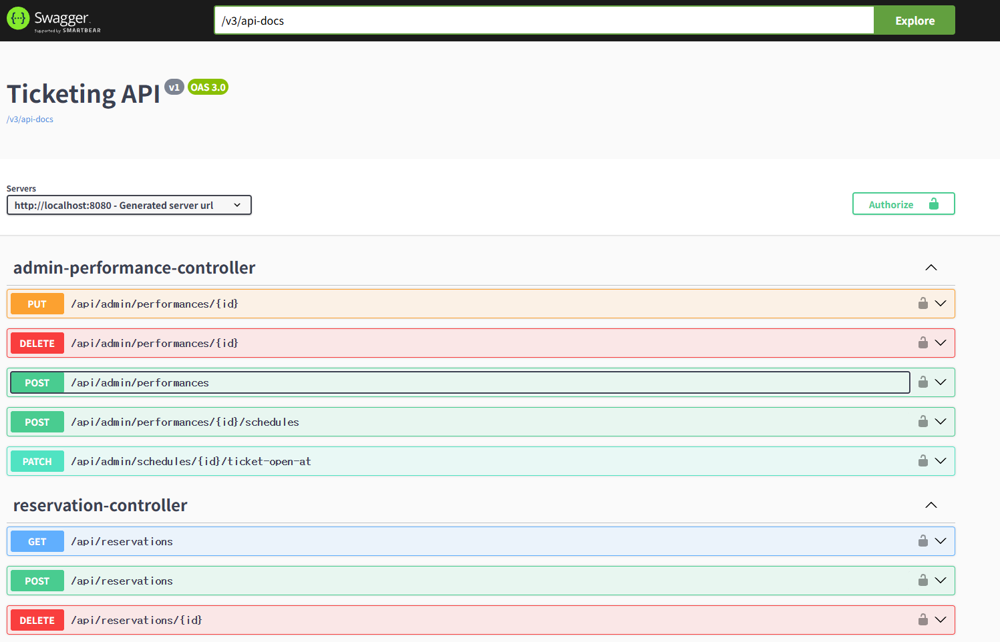

<table>
  <tr>
    <td width="50%" valign="top"><b>🌫 <a href="https://github.com/Gugaeun/PM25">PM25</a></b> — 실시간 24시간 예측 화면 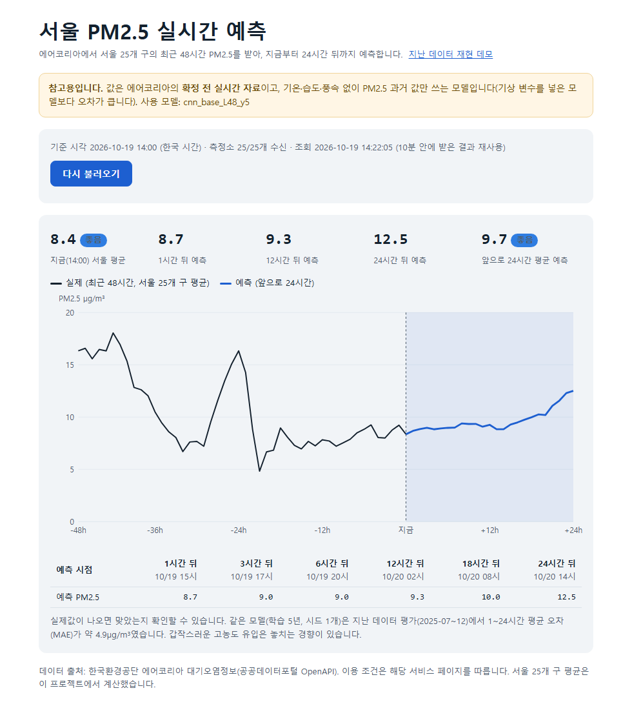</td>
    <td width="50%" valign="top"><b>🎮 <a href="https://github.com/Gugaeun/mini-game-hub">mini-game-hub</a></b> — ARCADIA 메인 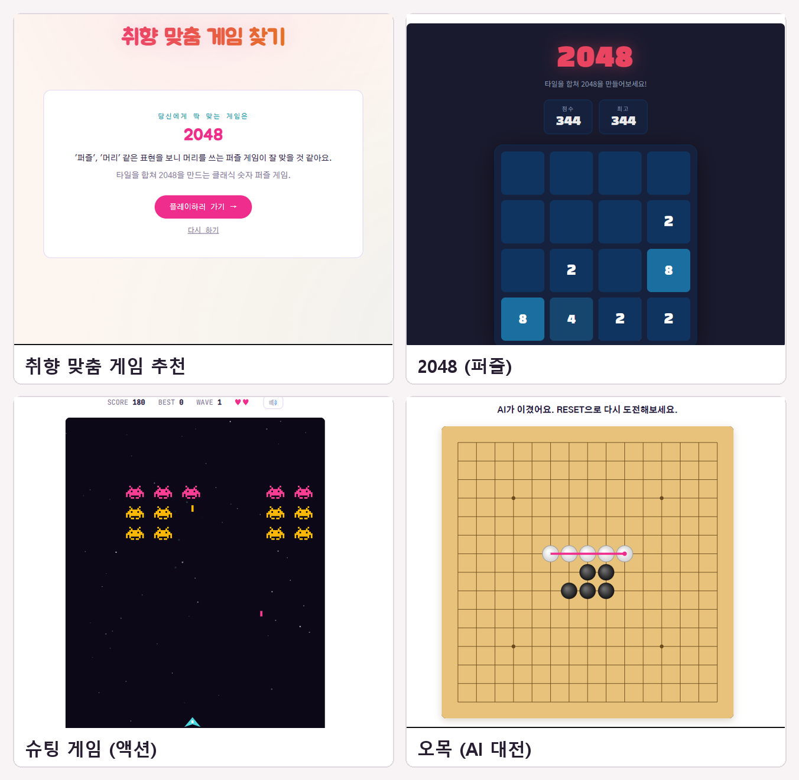</td>
  </tr>
  <tr>
    <td width="50%" valign="top"><b>👁 <a href="https://github.com/Gugaeun/Vision_ai">Vision_ai</a></b> — 진열대 이상 탐지(곰팡이 채소) 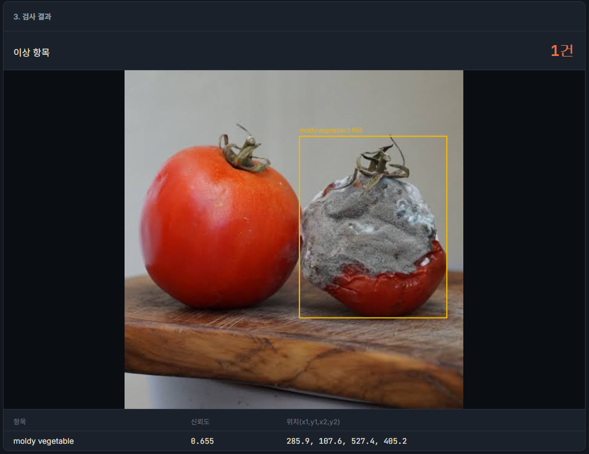</td>
    <td width="50%" valign="top"><b>🍚 <a href="https://github.com/Gugaeun/golmok-hankki">golmok-hankki</a></b> — 음식점 검색·지도 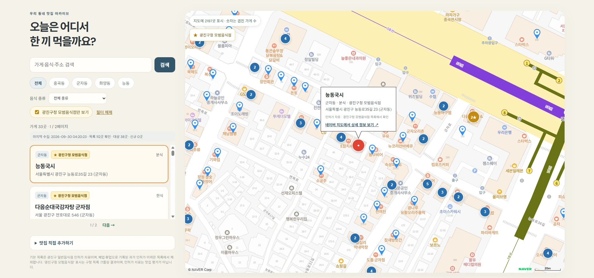</td>
  </tr>
  <tr>
    <td width="50%" valign="top"><b>🛰 <a href="https://github.com/Gugaeun/EuroSAT-Classification">EuroSAT-Classification</a></b> — PyTorch CNN 예측 샘플 </td>
    <td></td>
  </tr>
</table>

### 👥 팀 프로젝트

<table>
  <tr>
    <td width="50%" valign="top"><b>🚗 <a href="https://github.com/Gugaeun/LPR_System">LPR_System</a></b> — 번호판 인식 앱 화면 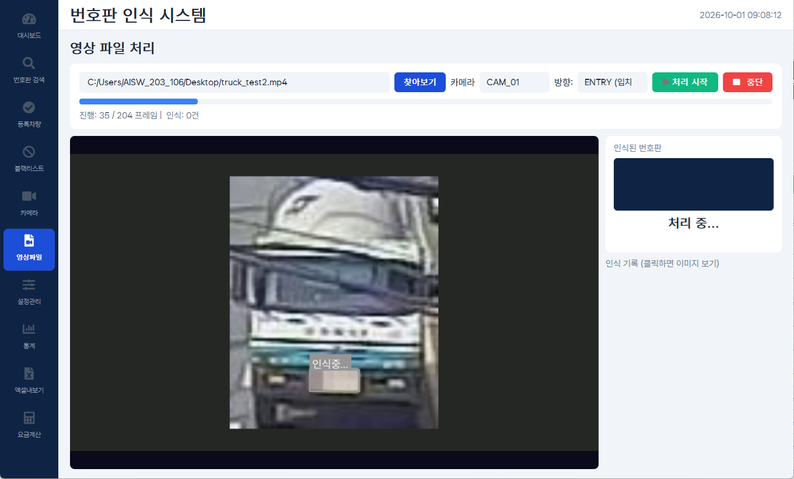</td>
    <td width="50%" valign="top"><b>🌿 <a href="https://github.com/Gugaeun/Korean_Travel">Korean_Travel</a></b> — 산책 ON 메인 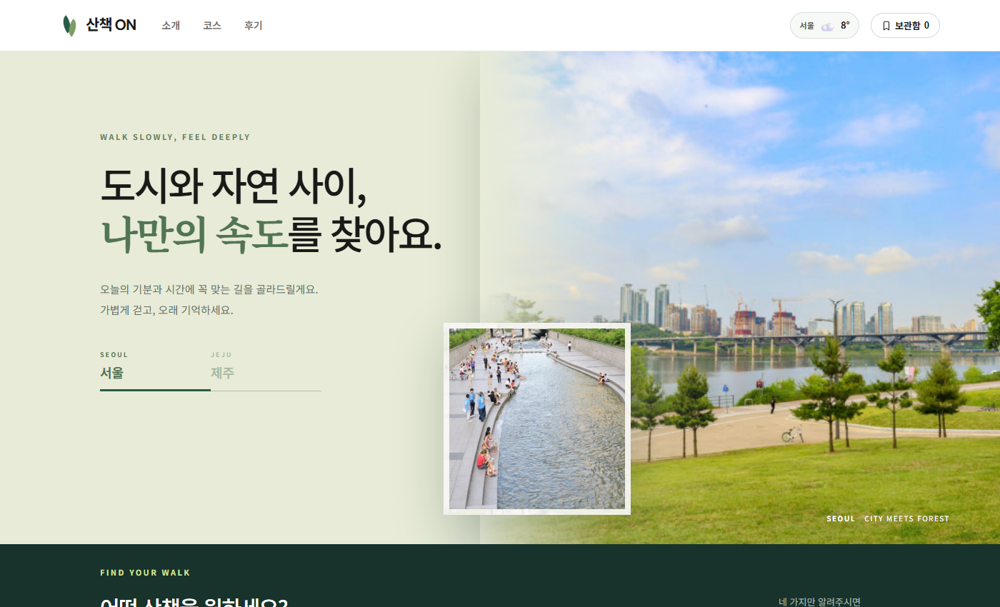</td>
  </tr>
</table>

**🎬 [Korea_Movie_Review](https://github.com/Gugaeun/Korea_Movie_Review)** — 홈 · 취향 추천(영화 선택) · 추천 결과와 근거

  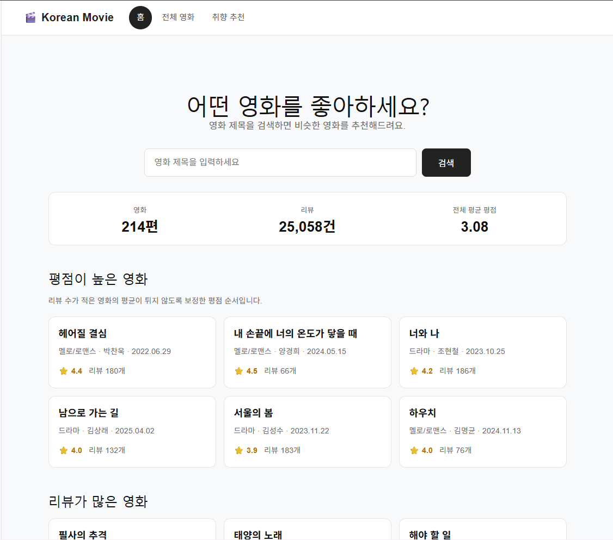
  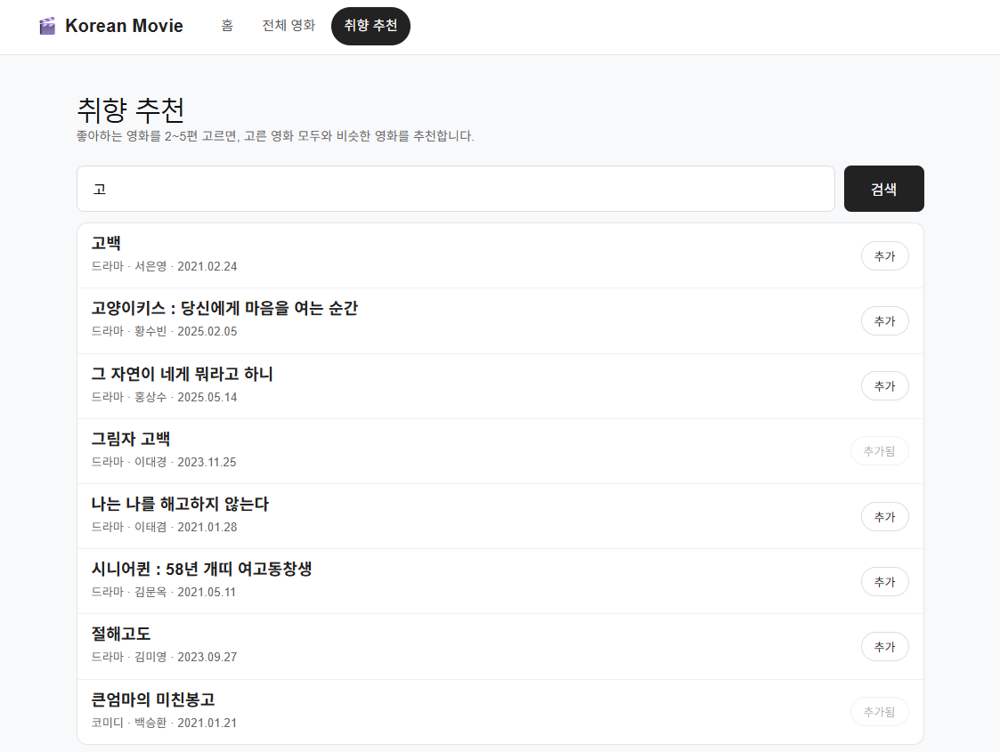
  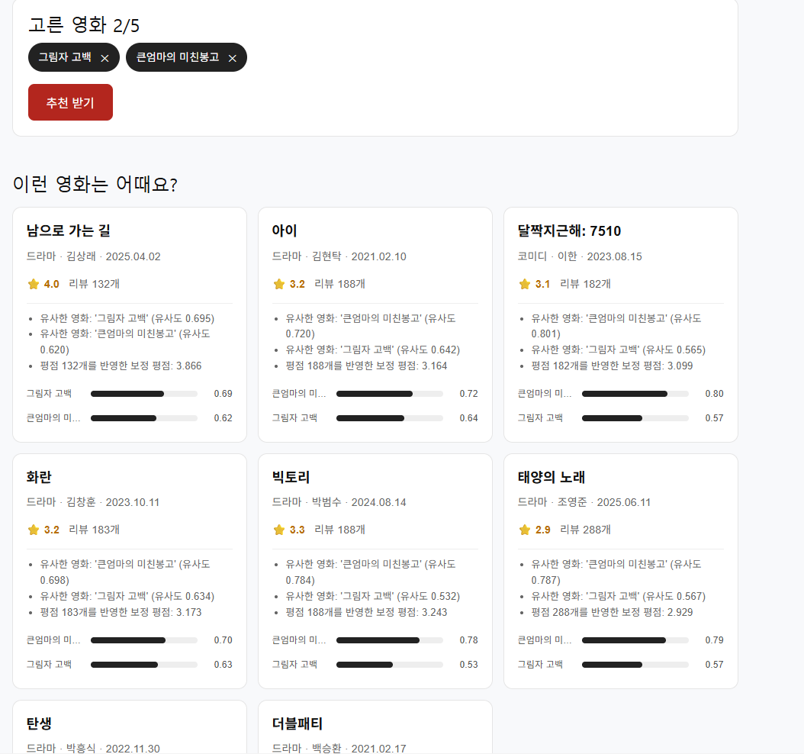

## 프로젝트 하이라이트

- **Ticketing**: 동시성 문제를 일부러 재현하고 락 방식(none / pessimistic / optimistic)을 바꿔 가며 *문제 → 원인 → 해결 → 수치*로 정리. Oracle 기준 k6 부하 테스트와 조회 최적화 기록 포함
- **PM25**: persistence 대비 LSTM·1D-CNN(+기상 변수)이 오차를 줄이는지 분기별 재검증하고, 고농도 구간 예측 실패와 개선 시도까지 기록
- **mini-game-hub**: 게임 규칙을 화면과 분리한 엔진(`*Engine.js`)으로 만들어 시뮬레이션 테스트 가능
- **Vision_ai**: 같은 사진·프롬프트로 세 가지 open-vocabulary 탐지 모델을 비교한 문서(`docs/comparison.md`)와 폴더별 README 포함
- **EuroSAT-Classification**: 같은 데이터에서 DNN은 ANN 대비 파라미터 2배 이상 늘려도 정확도가 7~12%p만 올랐고, CNN은 약 219만 개 파라미터로 90.9~93.7% 달성
- **golmok-hankki**: 이름·주소·거리(18m 이내)로 같은 음식점을 판별하는 중복 제거 기준 설계
- **LPR_System**: 인식 실패를 검출·OCR 단계로 나눠 측정하고 원인을 대조 실험으로 확인
- **Korea_Movie_Review**: 추천 품질 평가 보고서와 Docker 배포 문서 포함

## Contact

- GitHub: [@Gugaeun](https://github.com/Gugaeun)
- Email: yms07050@gmail.com
